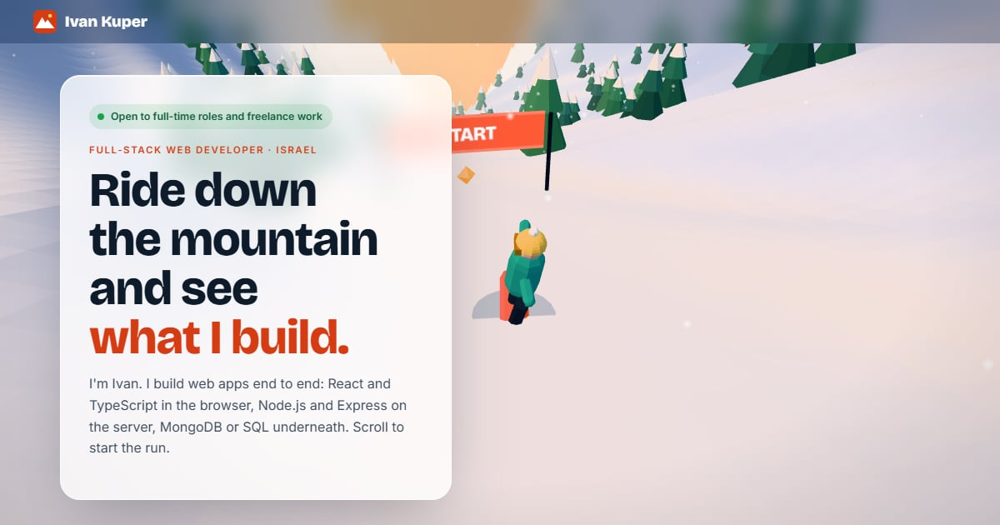

# Ivan Kuper – Portfolio

My personal portfolio site. The main page is a small 3D snowboarding run: scroll (or swipe) to ride down the
mountain, steer with the arrow keys to catch stars, and stop at a checkpoint for each project.

**Live:** https://ivankuper.github.io



## Pages
- `index.html` + `snow/` – the 3D run (three.js from a CDN, plain JavaScript and CSS, no build step).
  Without WebGL, or if three.js cannot load, the same content shows as normal cards.
- `classic.html` – my earlier one-page portfolio (HTML, CSS, Bootstrap).

## Built with
HTML, CSS, JavaScript, three.js. Fonts (Bricolage Grotesque, Inter) are served from the repo.

## Run locally
Serve the folder with any static server (the page uses JavaScript modules), for example:

```
python -m http.server 5173
```

then open http://localhost:5173.
